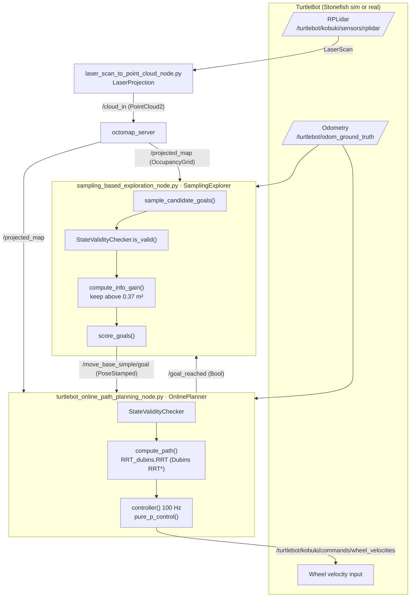

# LiDAR-Based Autonomous Exploration with Dubins RRT*

A ROS Noetic package that lets a TurtleBot (Kobuki) with a 2D LiDAR explore an unknown environment on its own: it samples goals by information gain, plans curvature-constrained paths with a Dubins RRT\*, and tracks them with a pure pursuit controller.

<!-- TODO: add a demo GIF (< 10 MB) at media/demo.gif and uncomment the line below. -->
<!--  -->
> **Demo:** TODO. No recording is included in the repository yet.

## Problem and approach

A robot entering an unknown building has no map, so it can't plan to a fixed target. It has to choose where to go next so that it uncovers as much unknown space as possible, then reach that point safely with a differential-drive base that can't turn on a dime.

The package splits this into three steps:

1. **Mapping.** The LiDAR scan is converted to a point cloud and fused into an OctoMap. Its 2D projection (`/projected_map`) is the occupancy grid that every other component uses.
2. **Goal selection.** Once per second the explorer samples 50 random candidates. It drops any candidate within 0.22 m of an obstacle, then scores the rest by the unknown area inside a 1 m window (minus a distance penalty). Candidates with less than 0.37 m² of unknown area are ignored. After more than 10 cycles with no informative candidate, exploration is declared complete and the node logs the explored and unexplored cell percentages.
3. **Planning and control.** RRT\* (up to 3000 iterations, 0.4 m step, 0.3 goal bias) connects nodes with Dubins curves (0.2 m turning radius, sampled every 0.1 m). Each sample is collision-checked against the grid. A pure pursuit controller follows the result. If a map update invalidates the path, the robot replans. It gives up after 7 failed planning attempts.

**Key result:** TODO. The repository has no recorded measurements (coverage percentage, exploration time, path length) to quote. The exploration node prints the coverage figures at the end of a run, and they should be added here.

## Architecture

The diagram follows the topics and calls in the source code. Topic names are for the simulation launch; the hardware variants are listed below the diagram.



The `*_real.py` nodes differ from the simulation versions as follows:

| | Simulation | Real robot |
|---|---|---|
| Odometry topic | `/turtlebot/odom_ground_truth` | `/turtlebot/kobuki/odom` |
| Command output | `Float64MultiArray` wheel velocities | `Twist` on `/turtlebot/kobuki/commands/velocity` |
| Fixed frame | `world_ned` | `odom` |
| Goal sampling area | whole map | `[-1.0, 2.0] × [-1.5, 1.5]` m |
| Pure pursuit | 0.08 m lookahead, 0.4 m/s | 0.05 m lookahead, 0.15 m/s (halved above 0.3 rad error) |

Earlier hand-drawn diagrams are kept in [`docs/`](docs/), along with an `rqt_graph` capture of the simulation (`docs/rosgraph.png`).

## Tested versions

These versions were used to build the package and start the nodes (see [Install](#install) and [CI](.github/workflows/ci.yml)):

| Component | Version |
|---|---|
| OS | Ubuntu 20.04 (Docker image `ros:noetic-robot`) |
| ROS | Noetic |
| Python | 3.8 |
| Build tool | colcon (`colcon-common-extensions` from pip) |
| `dubins` | 1.0.1 (pip) |
| numpy / scipy / matplotlib / Pillow | Ubuntu 20.04 `python3-*` packages |

The Python-only CI job uses Python 3.8 with numpy 1.24.4, scipy 1.10.1, matplotlib 3.7.5, Pillow 10.4.0 and dubins 1.0.1.

The full simulation (Stonefish) and the real robot were **not** re-run while preparing this release.

## Install

Verified in a `ros:noetic-robot` container:

```bash
mkdir -p ~/catkin_ws/src && cd ~/catkin_ws/src
git clone <this-repository-url> lidar_based_exploration
cd ~/catkin_ws

# ROS build dependencies
rosdep update
rosdep install --from-paths src --ignore-src -y \
  --dependency-types buildtool --dependency-types build --dependency-types build_export

# Python runtime dependencies (use the apt packages so they match ROS Noetic's numpy)
sudo apt-get install -y python3-numpy python3-scipy python3-matplotlib python3-pil
pip3 install dubins

source /opt/ros/noetic/setup.bash
colcon build
source install/setup.bash
```

> Installing numpy/scipy/matplotlib with pip on top of ROS Noetic's numpy 1.17 fails with
> `Matplotlib requires numpy>=1.20`. Use the apt packages as shown above.

To install the remaining runtime dependencies (`laser_geometry`, `octomap_server`, `rviz`, `rqt_gui`), run `rosdep install --from-paths src --ignore-src -y` without the `--dependency-types` filter.

## Run

### Start the nodes (verified)

With a `roscore` running, both main nodes start and wait for map, odometry and goal data:

```bash
rosrun lidar_based_exploration turtlebot_online_path_planning_node.py
rosrun lidar_based_exploration sampling_based_exploration_node.py
```

### Full simulation (not re-verified)

```bash
roslaunch lidar_based_exploration stonefish.launch
```

This launch file also starts the Stonefish simulator, the LiDAR conversion node, OctoMap, RViz and an RQT GUI. It needs these packages, which are not part of this repository: `stonefish_ros`, `turtlebot_simulation`, `kobuki_description`, `octomap_server`, and an `odom_to_tf.py` odometry-to-TF broadcaster (see the TODO in `launch/turtlebot_basic.launch`).

### Real robot (not re-verified)

```bash
roslaunch lidar_based_exploration real.launch
```

The real-robot launch uses `config/octomap_real.yaml` (0.05 m resolution, bounding box `[-1, 2] × [-1, 2] × [0, 2]` m).

## Results

TODO: no quantitative results (coverage, exploration time, success rate) or recordings are stored in this repository. Add them here once they are available.

## Repository layout

```
.
├── CMakeLists.txt, package.xml   catkin package (message generation + install rules)
├── msg/GoalStatus.msg            custom message (generated; not used by the nodes yet)
├── launch/
│   ├── stonefish.launch          simulation: robot + mapping + exploration + planning
│   ├── turtlebot_basic.launch    Stonefish simulator and robot description
│   └── real.launch               real TurtleBot
├── config/                       RViz, RQT and OctoMap configuration
├── src/
│   ├── laser_scan_to_point_cloud_node.py
│   ├── sampling_based_exploration_node.py  (+ _real)
│   ├── turtlebot_online_path_planning_node.py  (+ _real)
│   └── utils_lib/
│       ├── exploration_sampling.py   goal sampling, information gain, scoring
│       ├── online_planning.py        validity checker, planner wrapper, pure pursuit (+ _real)
│       └── RRT_dubins.py             Dubins RRT* planner
├── docs/                         diagrams and rqt_graph capture
├── requirements.txt              pip dependencies of utils_lib
└── .github/workflows/ci.yml      colcon build + Python import test
```

## Known limitations

These are documented in the code with TODO notes. The algorithm behaviour has been left unchanged.

- In `RRT.rewire`, the candidate cost can never be lower than the current cost, so RRT\* rewiring never takes effect. The branch also refers to an undefined `self.node`.
- `RRT.optimal_parent` does not update the best cost inside its loop.
- The `RRT` constructor ignores its `dominion` argument and always samples over the map extent. The real-robot bounds therefore do not restrict planning.
- The `min_clearance` argument of `sample_candidate_goals` is unused.

## Citation

If you use this work, please cite it using [`CITATION.cff`](CITATION.cff).

## Licence

Released under the [Apache License 2.0](LICENSE).

## Acknowledgements

- **Gebrecherkos Gebrezgabhier** and **Pravin Oli** designed and implemented the system together.
- Thanks to **Narcis Palomeras**, **Sebastian** and **Martha** for supervision and guidance.
- Built on [ROS](https://www.ros.org/), [OctoMap](https://octomap.github.io/), the [Stonefish](https://github.com/patrykcieslak/stonefish) simulator, and the [`dubins`](https://pypi.org/project/dubins/) Python package.
