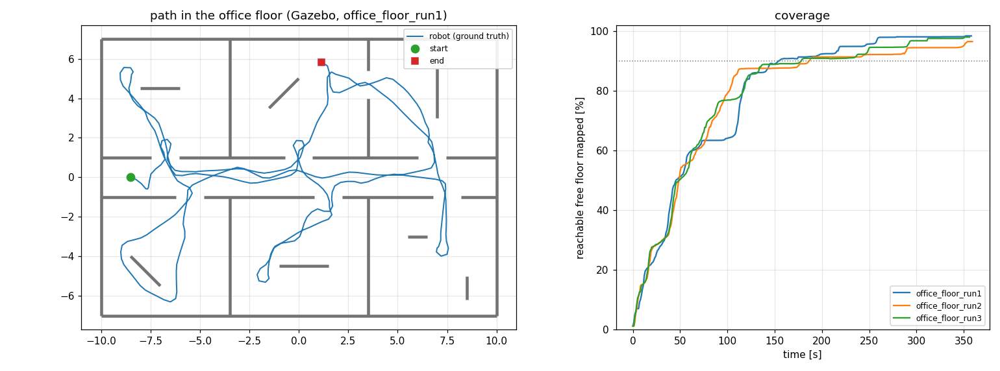
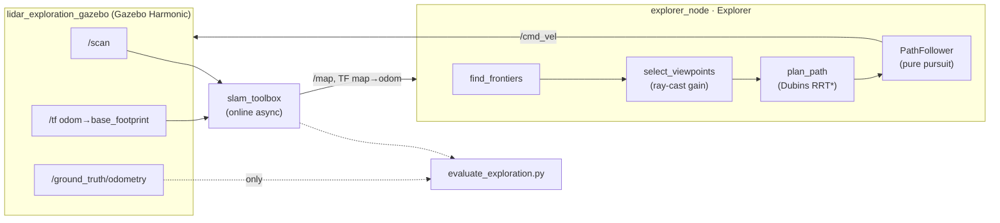

# Autonomous LiDAR Exploration with Frontiers and Dubins RRT\* (ROS 2)

A differential-drive robot with a 2-D lidar maps an unknown office floor on its own: it picks the frontier viewpoint
that reveals the most unknown floor, plans a curvature-limited path to it with Dubins RRT\*, follows it with pure
pursuit, and stops when nothing reachable is left to see. C++ for **ROS 2 Jazzy** and **Gazebo Harmonic** on Ubuntu
24.04, with slam_toolbox as the mapper.



## Result

Three headless runs on the simulated office floor (Gazebo, 360-beam lidar to 12 m with 1 cm noise, slam_toolbox),
each evaluated against the floor plan by [`evaluate_exploration.py`](lidar_exploration/scripts/evaluate_exploration.py).
The CSV logs are in [`docs/results/`](docs/results); `python3 tools/plot_run.py docs/results/office_floor_run*.csv
out.png` recomputes the figure and the numbers.

| run | stopped by itself after | 90 % coverage after | distance driven | final coverage of the reachable free floor | goals reached / replans |
|---|---|---|---|---|---|
| [1](docs/results/office_floor_run1.csv) | 358 s | 154 s | 117.7 m | **98.4 %** (259.7 m²) | 5 / 7 |
| [2](docs/results/office_floor_run2.csv) | 359 s | 187 s | 117.5 m | **96.5 %** (254.7 m²) | 4 / 4 |
| [3](docs/results/office_floor_run3.csv) | 356 s | 179 s | 118.7 m | **98.0 %** (258.6 m²) | 5 / 3 |

In every run all occupied map cells lie within 15 cm of a real wall surface, and no free cell lies inside a wall. The
explorer reaches only a few of its goals: most are dropped on the way because the lidar has already mapped the area
around them, which is the intended behaviour. The runs differ only through the timing of the simulation; the explorer
itself is deterministic.

## How it works



Every second slam_toolbox publishes a new map; the explorer pads it with a 1 m band of unknown cells (a SLAM map ends
where the observations end, so free space may touch its edge) and then:

1. **Frontiers** — free cells with an unknown 4-neighbour, grouped into 8-connected clusters
   (Yamauchi, 1997). Clusters of fewer than 5 cells are ignored.
2. **Viewpoints** — around up to 150 random frontier cells it samples a free cell at least 0.5 m from any obstacle
   and scores it by the unknown area a 360° lidar would see from there (120 rays to 12 m, stopping at occupied
   cells), discounted by distance: `gain · exp(−0.15 · d)`. Viewpoints that would reveal less than 1 m² are dropped.
3. **Path** — the best viewpoints are tried in order with
   [learn-motion-planning](https://github.com/Rudip1/learn-motion-planning)'s Dubins RRT\* (turning radius 0.3 m) on
   the occupied cells inflated by 0.45 m; the robot's body corners are 0.36 m from its centre. A direct Dubins curve is
   used when it is free. Otherwise RRT\* samples in the start–goal bounding box grown by 2 m, then 6 m, then the whole
   map: a box much larger than the detour wastes the iterations on long, winding paths. Unknown cells are traversable
   by default: slam_toolbox leaves unknown speckles and unmapped strips where a long beam found no return, and treating
   them as walls blocks almost every path.
4. **Following** — pure pursuit with a 0.3 m look-ahead at 0.35 m/s, turning in place when the look-ahead point is
   more than 1 rad off the heading.
5. **Re-checking** — on every new map the rest of the path is checked against the inflated obstacles (a wall seen in
   formerly unknown space triggers a replan), and a goal whose surroundings have been mapped meanwhile is dropped.
   Goals that cannot be reached are avoided for 30 s, and for good after three failures.
6. **Finishing** — when three selections in a row, one map update apart, find no informative viewpoint.

The algorithm core (`exploration_core`) has no ROS dependency; `explorer_node` only converts messages and looks up
the robot pose in TF.

## Packages

| package | contents |
|---|---|
| [`lidar_exploration`](lidar_exploration) | `Explorer` and its parts (ROS-free C++ core), `explorer_node`, `evaluate_exploration.py`, launch, slam_toolbox and explorer parameters, RViz, tests |
| [`lidar_exploration_gazebo`](lidar_exploration_gazebo) | robot (URDF/xacro: diff drive, 12 m 2-D lidar), the office floor world and its wall list, ros_gz bridge, simulation launch |

The office floor (20 m × 14 m: a corridor, six rooms, furniture; 264 m² of reachable free floor) is generated by
[`make_office_floor.py`](lidar_exploration_gazebo/scripts/make_office_floor.py), which also writes the wall list that
the evaluation and the plot use.

## Build

Ubuntu 24.04, ROS 2 Jazzy, Gazebo Harmonic (`ros-jazzy-ros-gz`), `ros-jazzy-slam-toolbox`.

```bash
mkdir -p ~/explore_ws/src && cd ~/explore_ws/src
git clone https://github.com/Rudip1/lidar-exploration.git
cd ~/explore_ws
rosdep install --from-paths src --ignore-src -y
source /opt/ros/jazzy/setup.bash
colcon build --cmake-args -DCMAKE_BUILD_TYPE=Release
source install/setup.bash
```

The first build downloads learn-motion-planning (pinned commit). Offline, point CMake at a local checkout:
`colcon build --cmake-args -DFETCHCONTENT_SOURCE_DIR_LEARN_MOTION_PLANNING=/path/to/learn-motion-planning`.

## Run

```bash
# Gazebo + slam_toolbox + explorer + RViz (frontiers in orange, goal arrow, planned path)
ros2 launch lidar_exploration exploration.launch.py

# The reproducible experiment: headless, evaluated against the floor plan, then shut down
ros2 launch lidar_exploration exploration.launch.py gui:=false rviz:=false evaluate:=true output:=run.csv
python3 src/lidar-exploration/tools/plot_run.py run.csv run.png
```

Parameters are in [`config/explorer.yaml`](lidar_exploration/config/explorer.yaml) and
[`config/slam_toolbox.yaml`](lidar_exploration/config/slam_toolbox.yaml) (slam_toolbox's online-async defaults with a
1 s map update, keyframes every 0.2 m and the full 12 m lidar range).

## Tests

```bash
colcon test --packages-select lidar_exploration && colcon test-result --verbose
```

No simulator needed:

- **Parts** — frontier clusters on hand-made maps; padding turns the map edge into a frontier; the information gain
  of open space is the sensor disc (πr²) and a wall cuts off exactly the circular segment behind it; viewpoints are
  free, clear of obstacles and ranked by score; the planner goes through a door while keeping the inflation distance,
  finds no path when the door is closed, crosses unknown space only when allowed, and can start inside the inflation;
  pure pursuit tracks a Dubins path to its end within 12 cm; the tests' floor plan equals the Gazebo world's wall list.
- **Whole loop** — the explorer drives an ideal robot around the office floor while a simulated lidar builds the map
  the way slam_toolbox does (a beam with no return within 12 m clears nothing). For three seeds it must finish by
  itself, map more than 97 % of the reachable free floor, and keep its centre more than 0.41 m from every wall cell
  (0.36 m body corner + 5 cm).

## Limitations

- The information gain is optimistic: unknown cells do not block its rays, and it ignores the beams that will find no
  return. It ranks viewpoints well but overestimates what each will reveal.
- Driving through unknown space relies on the map being re-checked every second at 0.35 m/s; a faster robot would
  need a local obstacle check on the raw scan.
- Tested in simulation only. The original ROS 1 version (Python, TurtleBot 2 in Stonefish, OctoMap) is kept at tag
  [`ros1-noetic`](https://github.com/Rudip1/lidar-exploration/tree/ros1-noetic).

## Citation

If you use this work, please cite it using [`CITATION.cff`](CITATION.cff).

## Licence

Released under the [Apache License 2.0](LICENSE).

## Acknowledgements

- **Gebrecherkos Gebrezgabhier** and **Pravin Oli** designed and implemented the original ROS 1 system together.
- Thanks to **Narcis Palomeras**, **Sebastian** and **Martha** for supervision and guidance.
- Built on [ROS 2](https://www.ros.org/), [Gazebo](https://gazebosim.org/),
  [slam_toolbox](https://github.com/SteveMacenski/slam_toolbox) and
  [learn-motion-planning](https://github.com/Rudip1/learn-motion-planning).
